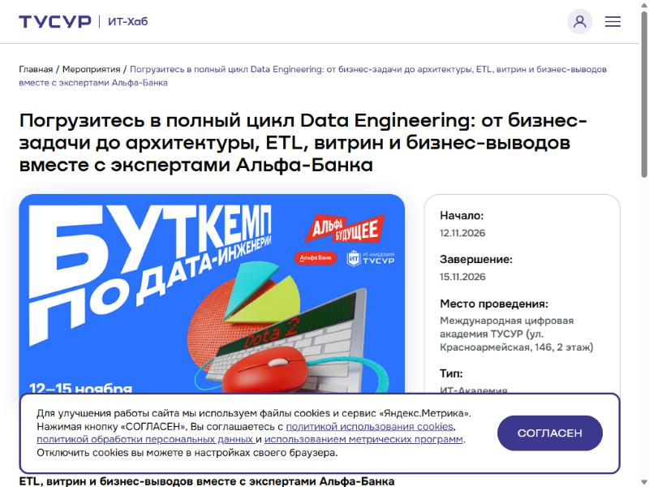

# Dota 2 Lakehouse: ранний пуш и урон по зданиям

Участие в буткэмпе по дата-инженерии (ТУСУР, при участии экспертов Альфа-Банка, 12–15 ноября 2026): [страница мероприятия](https://it-hub.tusur.ru/events/offline-bootcamp-tusur-2026).



Учебный проект буткэмпа (Команда 1, кейс 13 «Способности по башням»): аналитическое хранилище на матчах Dota 2 со слоями **RAW → STAGE → MART**, инкрементальной загрузкой на Spark и SQL, оркестрацией в Airflow, лайнэджем в Marquez и дашбордом в Superset.

## Результат в цифрах

- **218 805 матчей** в анализе из ~325 тыс. в RAW (без режима Turbo, матчи от 15 минут, ровно 10 игроков).
- **8 DAG** в Airflow (4 STAGE + 4 MART), 54 успешных запуска и 0 неуспешных; средняя длительность прогона от 3 до 21 минуты (`data/airflow_run_durations.csv`); **~24 млн строк** в слоях STAGE.
- Найдена и исправлена ошибка `INNER JOIN` в витрине: к анализу вернулось ~19 тыс. матчей (≈199 тыс. → ≈219 тыс.).
- **Доля побед растёт с 34% до 91%** с числом снесённых башен соперника к 15-й минуте (0 → 4+ башен). Но при контроле золота эффект исчезает (OR 0,855): связь, а не причина.
- **43 из 126 героев** бьют здания значимо сильнее нормы своей позиции (лидеры Pugna, Visage, Shadow Shaman).
- Весь путь: гипотезы, ER, ETL, Data Governance, лайнэдж, дашборд, финальная презентация (`docs/`).

## Стек

| Слой / задача | Инструмент |
|---|---|
| Источники | PostgreSQL, MongoDB |
| Хранилище | Apache Iceberg в S3-совместимом хранилище (RustFS), каталог `lakehouse` |
| SQL-движок | Trino |
| Оркестрация | Apache Airflow (по одному DAG на таблицу STAGE и MART) |
| Лайнэдж метаданных | Marquez (OpenLineage) |
| BI | Apache Superset |
| Исследование | JupyterHub / JupyterLab, pandas, matplotlib |
| Портал платформы | веб-портал: каталог, запуск потоков, учебные кейсы |

## Архитектура

```
PostgreSQL / MongoDB
        │  выгрузка без потери контекста
        ▼
   RAW  (Iceberg, исходные поля и типы)
        │  очистка, типизация, объединение, производные поля
        ▼
 STAGE  t1_c13_matches · t1_c13_players · t1_c13_tower_hits · t1_c13_building_falls
        │  агрегаты под вопросы бизнеса
        ▼
  MART  t1_c13_team_early_push(_v2) · t1_c13_hero_tower_damage · t1_c13_ability_building_damage
        │
        ▼
 Superset-дашборд «Кейс 13 · Способности по башням»
```

Каждая таблица собирается отдельным DAG в Airflow, зависимости между ними задаются датасетами. Лайнэдж RAW→STAGE→MART виден в Marquez.

### Как платформы работают между собой

```
PostgreSQL / MongoDB ──(общие потоки админов, append)──► RAW (Iceberg на S3, каталог lakehouse)
Портал ──генерирует DAG из SQL──► Airflow ──запускает──► Spark 4.1.2 ──пишет Iceberg──► STAGE → MART
Trino читает тот же каталог ──► Superset, предпросмотр в Портале, ноутбуки
JupyterHub ──SparkSessionContext──► spark-master:7077 (и trino-клиент ──► Trino)
OpenLineage-события ──► Marquez          Метаданные и история запусков (meta.*) ──► PostgreSQL
```

Подробно по каждой связке (кто кого вызывает, через что, что бывает при сбое: `OUT_OF_SPILL_SPACE`, лимит стадий, `CREATE OR REPLACE` как полная пересборка, инкремент только через Spark-скрипт) — в [`docs/architecture.md`](docs/architecture.md).

### Объёмы данных

| Слой | Таблица | Строк |
|---|---|---|
| STAGE | `t1_c13_matches` | 220 021 |
| STAGE | `t1_c13_players` | 2 200 210 |
| STAGE | `t1_c13_tower_hits` | 13 603 492 |
| STAGE | `t1_c13_building_falls` | 7 920 756 |
| MART | `t1_c13_team_early_push` | 400 950 |
| MART | `t1_c13_team_early_push_v2` | 438 654 |
| MART | `t1_c13_hero_tower_damage` | 1 905 |
| MART | `t1_c13_ability_building_damage` | 17 058 |

Фильтры STAGE: без режима Turbo, матчи от 15 минут, ровно 10 игроков и 10 разных героев. Из ~325 тыс. матчей RAW остаётся ~220 тыс.

## Гипотезы и результаты

Данные: ~18 часов матчей одного патча (14–15.10.2026).

- **H1. Часть героев бьёт здания сильнее нормы своей позиции.** Подтверждена: лидеры по индексу Pugna, Visage, Shadow Shaman, Broodmother, Lycan; индекс в 2–3 раза выше ожидаемого для позиции.
- **H2. Урон за удар зависит от стадии игры и типа здания.** Подтверждена: ступенька T1 → T4 общая для физических источников; у способностей эффект зависит от уровня и усилений. Из способностей по урону зданиям лидируют Moon Glaives (Luna), Elder Dragon Form (Dragon Knight), Nether Blast (Pugna).
- **H3. Ранний пуш связан с победой.** Доля побед по числу снесённых башен соперника к 15-й минуте:

| Башен к 15-й минуте | 0 | 1 | 2 | 3 | 4+ |
|---|---|---|---|---|---|
| Доля побед | 34,1% | 49,8% | 64,1% | 77,0% | 90,9% |

  Но при контроле золота эффект не подтверждается (OR 0,855): раннее преимущество идёт через золото, связь не причинная.

- **Структура урона по зданиям:** 61% после 30-й минуты, 30% в 15–30, 9% в первые 15; источники: автоатака 85%, призывы 8%, способности 6%, предметы 1%.

Ограничения: один патч, позиция игрока оценена по net worth.

### Найденная и исправленная ошибка

В первой версии витрины `team_early_push` стоял `INNER JOIN` на башни, и матчи, где одна сторона не потеряла ни одной башни, выпадали (≈199 тыс. вместо ≈219 тыс.). Исправлено на `LEFT JOIN`, выпущена `team_early_push_v2`; проверка в ноутбуке `notebooks/case13_h3_fix_check.md` (по две строки на матч, ключ матч×сторона уникален, доли побед совпадают с выборкой 5%).

## ML: роли игроков (командная работа)

Ноутбук `notebooks/ml/polnostyu_rabochaya_model_bez_setki.ipynb` (с выводами ячеек) строит признаки игроков в MART (`mart.match_player_features`, очищенная версия) и в Spark MLlib:

1. **KMeans, k=5** (StandardScaler, признаки без нулевой дисперсии) размечает роли игроков, метки сохраняются в `mart.role_labels`;
2. **RandomForest** учится предсказывать роль: train 1 412 340 / test 353 250 строк, **F1 на тесте 0,9214**, accuracy 0,9211, AUC по классам 0,985–0,998; важность признаков в `mart.rf_feature_importance` (лидеры gpm, xpm, предметы по слотам), предсказания в `mart.rf_test_predictions`.

Авторство и вклад: модель и проверку в Jupyter сделал коллега по Команде 1 Владислав Рогачев. Моя часть в ML-кейсе: платформа, оркестрация потоков, дашборды и всё остальное вокруг модели (хранение таблиц в слоях, запуск и связка сервисов). Отдельно мной выполнен кейс 13 (STAGE/MART, SQL и Spark-скрипты, гипотезы H1–H3, дашборд).

## Содержимое репозитория

Все пути ниже кликабельны.

- [sql/](<sql/>) — SQL потоков с комментариями и проверками качества: STAGE — [t1_c13_building_falls.sql](<sql/stage/t1_c13_building_falls.sql>), [t1_c13_matches.sql](<sql/stage/t1_c13_matches.sql>), [t1_c13_players.sql](<sql/stage/t1_c13_players.sql>), [t1_c13_tower_hits.sql](<sql/stage/t1_c13_tower_hits.sql>); MART — [t1_c13_ability_building_damage.sql](<sql/mart/t1_c13_ability_building_damage.sql>), [t1_c13_hero_tower_damage.sql](<sql/mart/t1_c13_hero_tower_damage.sql>), [t1_c13_team_early_push.sql](<sql/mart/t1_c13_team_early_push.sql>); учебный запрос — [sql/explore/](<sql/explore/>)
- [spark/](<spark/>) — инкрементальные Spark-скрипты (окно по `sys_insert_stamp` в RAW, удаление по ключу и append): [t1_c13_building_falls.py](<spark/t1_c13_building_falls.py>), [t1_c13_matches.py](<spark/t1_c13_matches.py>), [t1_c13_players.py](<spark/t1_c13_players.py>), [t1_c13_team_early_push.py](<spark/t1_c13_team_early_push.py>), [t1_c13_tower_hits.py](<spark/t1_c13_tower_hits.py>)
- [ddl/](<ddl/>) — схемы таблиц STAGE и MART: [mart_t1_c13_ability_building_damage.sql](<ddl/mart_t1_c13_ability_building_damage.sql>), [mart_t1_c13_hero_tower_damage.sql](<ddl/mart_t1_c13_hero_tower_damage.sql>), [mart_t1_c13_team_early_push.sql](<ddl/mart_t1_c13_team_early_push.sql>), [mart_t1_c13_team_early_push_v2.sql](<ddl/mart_t1_c13_team_early_push_v2.sql>), [stage_t1_c13_building_falls.sql](<ddl/stage_t1_c13_building_falls.sql>), [stage_t1_c13_matches.sql](<ddl/stage_t1_c13_matches.sql>), [stage_t1_c13_players.sql](<ddl/stage_t1_c13_players.sql>), [stage_t1_c13_tower_hits.sql](<ddl/stage_t1_c13_tower_hits.sql>)
- [data/](<data/>) — сэмплы MART, счётчики, запуски Airflow, выводы дашборда: [airflow_case13_last_runs.txt](<data/airflow_case13_last_runs.txt>), [airflow_run_durations.csv](<data/airflow_run_durations.csv>), [mart_t1_c13_ability_building_damage_sample50.csv](<data/mart_t1_c13_ability_building_damage_sample50.csv>), [mart_t1_c13_hero_tower_damage_sample50.csv](<data/mart_t1_c13_hero_tower_damage_sample50.csv>), [mart_t1_c13_team_early_push_sample50.csv](<data/mart_t1_c13_team_early_push_sample50.csv>), [mart_t1_c13_team_early_push_v2_sample50.csv](<data/mart_t1_c13_team_early_push_v2_sample50.csv>), [row_counts_stage.txt](<data/row_counts_stage.txt>), [superset_dashboard_conclusions.md](<data/superset_dashboard_conclusions.md>), [winrate_by_towers_down_15.csv](<data/winrate_by_towers_down_15.csv>); выписка из метаданных платформы [data/meta/](<data/meta/>): [column_metadata.csv](<data/meta/column_metadata.csv>), [job_runs.csv](<data/meta/job_runs.csv>), [table_config.csv](<data/meta/table_config.csv>)
- [docs/](<docs/>) — артефакты проекта: [01_hypotheses.md](<docs/01_hypotheses.md>), [02_er_diagram.md](<docs/02_er_diagram.md>), [03_preprocessing.md](<docs/03_preprocessing.md>), [04_backlog.md](<docs/04_backlog.md>), [05_etl.md](<docs/05_etl.md>), [06_flow_naming.md](<docs/06_flow_naming.md>), [07_data_governance.md](<docs/07_data_governance.md>), [08_dashboard.md](<docs/08_dashboard.md>), [08_dashboard_mockup.png](<docs/08_dashboard_mockup.png>), [09_presentation_outline.md](<docs/09_presentation_outline.md>), [10_hypotheses_analytics.md](<docs/10_hypotheses_analytics.md>), [Komanda1JUPITER_v6.pptx](<docs/Komanda1JUPITER_v6.pptx>), [architecture.md](<docs/architecture.md>), [bootcamp_materials_links.md](<docs/bootcamp_materials_links.md>), [lineage_dg.html](<docs/lineage_dg.html>), [tactics_and_retro.md](<docs/tactics_and_retro.md>); графики [docs/graphs/](<docs/graphs/>)
- [notebooks/](<notebooks/>) — [case13_h3_fix_check.md](<notebooks/case13_h3_fix_check.md>), [case13_tower_damage.py](<notebooks/case13_tower_damage.py>); ML: [notebooks/ml/](<notebooks/ml/>) ([polnostyu_rabochaya_model_bez_setki.ipynb](<notebooks/ml/polnostyu_rabochaya_model_bez_setki.ipynb>))
- [screens/](<screens/>) — скриншоты Портала, Airflow, Superset, Marquez, JupyterLab: [airflow_case13_dags_green.jpg](<screens/airflow_case13_dags_green.jpg>), [bootcamp_event_page_tusur.jpg](<screens/bootcamp_event_page_tusur.jpg>), [jupyter_case13_h3_fix_check_notebook.jpg](<screens/jupyter_case13_h3_fix_check_notebook.jpg>), [jupyter_case13_tower_damage_notebook.jpg](<screens/jupyter_case13_tower_damage_notebook.jpg>), [marquez_lineage_compact_full_graph.jpg](<screens/marquez_lineage_compact_full_graph.jpg>), [marquez_lineage_compact_nodes.jpg](<screens/marquez_lineage_compact_nodes.jpg>), [marquez_lineage_team_early_push_v2.jpg](<screens/marquez_lineage_team_early_push_v2.jpg>), [portal_cases.jpg](<screens/portal_cases.jpg>), [portal_catalog.jpg](<screens/portal_catalog.jpg>), [portal_overview_raw_stage_mart.jpg](<screens/portal_overview_raw_stage_mart.jpg>), [portal_runs.jpg](<screens/portal_runs.jpg>), [portal_start_trino_postgres_metadata.png](<screens/portal_start_trino_postgres_metadata.png>), [superset_dashboard_charts_h1_h2.jpg](<screens/superset_dashboard_charts_h1_h2.jpg>), [superset_dashboard_conclusions_1.jpg](<screens/superset_dashboard_conclusions_1.jpg>), [superset_dashboard_conclusions_2.jpg](<screens/superset_dashboard_conclusions_2.jpg>), [superset_dashboard_hero_table_top_abilities.jpg](<screens/superset_dashboard_hero_table_top_abilities.jpg>); графики Superset [screens/superset_charts/](<screens/superset_charts/>)
- [materials/](<materials/>) — исходные материалы буткэмпа, ссылка на каждый файл в разделе ниже и в [bootcamp_materials_links.md](<docs/bootcamp_materials_links.md>)
- [jupyter/](<jupyter/>) — учебные ноутбуки: [examples/](<jupyter/examples/>), [practice/](<jupyter/practice/>), [spark_practice/](<jupyter/spark_practice/>); [tools/](<tools/>) — вспомогательный скрипт запуска SQL ([README.md](<tools/README.md>))

## Материалы буткэмпа

Папка [`materials/`](materials/), а в ней по файлам:

- [Таймлайн буткэмпа](<materials/Таймлайн буткэмпа.png>)
- [Задание: практическая работа и описание проекта](<materials/Буткэмп Dota 2 — практическая работа.docx>)
- [Критерии оценки проекта (баллы)](<materials/Критерии оценки проекта.xlsx>)
- [Шаблон презентации для защиты](<materials/Шаблон презентации.pptx>)
- [Источники (PostgreSQL, MongoDB): описание полей и таблиц](<materials/Источники. Описание полей таблиц.md>)
- [Кейсы с гипотезами](<materials/analytics_cases.md>)
- [Учебные презентации, день 1 (основная)](<materials/Буткэмп День 1.pptx>)
- [День 1, доп. лекция: жизненный цикл проектной задачи](<materials/ЖЦ задачи_1.pptx>)
- [Учебные презентации, день 2 (основная)](<materials/Буткэмп День 2_Общая.pptx>)
- [День 2, доп. лекция: оркестрация (pptx)](<materials/Оркестратор.pptx>)
- [День 2, доп. лекция: оркестрация (pdf)](<materials/Оркестратор.pdf>)
- [День 2, доп. лекция: ИТ-инструменты буткэмпа (pptx)](<materials/ИТ-инструменты буткэмпа.pptx>)
- [День 2, доп. лекция: ИТ-инструменты буткэмпа (pdf)](<materials/ИТ-инструменты буткэмпа.pdf>)
- [Доска с артефактами по дням](<materials/Доска.pdf>)

## Авторство

Кейс 13 выполнен мной в составе Команды 1. Коллеги по команде делали свои кейсы (17 и 19); их код здесь не приводится.
