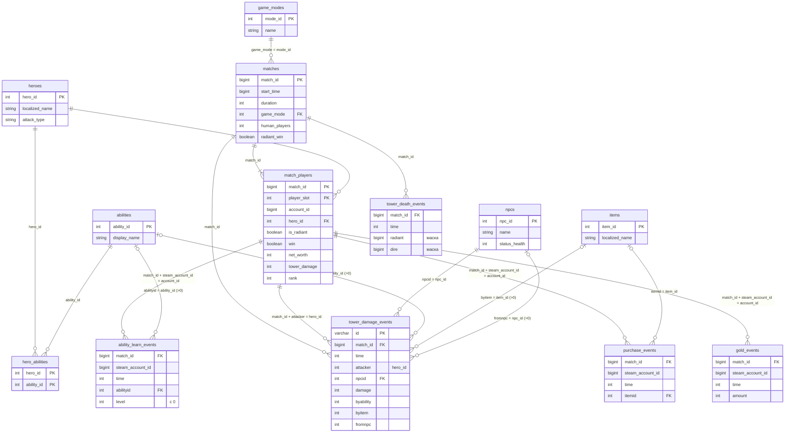

# День 1. ER-диаграмма

**Статус: готово.** Диаграмма и таблица связей проверены на данных RAW 13.11 (5% матчей).

## Диаграмма (Mermaid)

Источники: PostgreSQL, схема `dota` (справочники, `matches`, `match_players`) и MongoDB, база `dota_events` (события). В lakehouse они лежат как `lakehouse.raw.pg__*` и `lakehouse.raw.mongo__*`.

## Пути соединения и кратность

| Связь | Ключ | Кратность | Замечание |
|---|---|---|---|
| match_players → matches | `match_id` | N:1 | У 32% match_id из match_players нет строки в matches, поэтому только INNER JOIN. |
| matches → game_modes | `game_mode = mode_id` | N:1 | Режим 23 (Turbo) исключаем. |
| tower_damage_events → match_players | `(match_id, attacker = hero_id)` | N:1 | `attacker` содержит `hero_id`, а не steam id (в каталоге описано неверно). Пара не уникальна в 0,28% матчей (hero_id = 0, повтор героя), такие матчи исключаем. |
| tower_damage_events → npcs | `npcid = npc_id` | N:1 | 16–35 башни, 38–49 бараки, 50–51 трон. Тир только в имени (`tower1`…`tower4`). |
| tower_damage_events → abilities / items / npcs | `byability`, `byitem`, `fromnpc` | N:0..1 | Пустая ссылка = 0, не NULL. Справочники присоединяем по условию «> 0», LEFT JOIN. |
| ability_learn_events → abilities | `abilityid` | N:0..1 | `level` с 0; 1,5% строк с `abilityid = 0` отбрасываем. |
| tower_death_events → matches | `match_id` | N:1 | Состояние башен битовыми масками; упавшее здание = новый бит. |
| purchase_events → match_players | `(match_id, steam_account_id)` | N:1 | Нужна только покупка Helm of the Dominator (item 164) и Helm of the Overlord (635). |

## Замечания

- В MongoDB внешних ключей нет, связи логические.
- Названия полей Mongo в lakehouse записаны в нижнем регистре без подчёркиваний.
- Во всех RAW-таблицах есть `sys_insert_stamp`, `job_id`, `src_modified_stamp`.
- Анонимный игрок: `account_id = 4294967295`.
